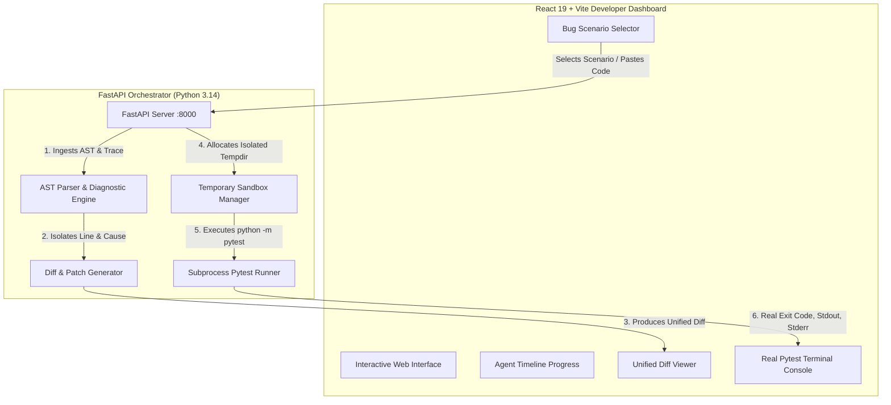

# 🩺 RepoMedic AI — Agentic CI Failure Investigator

**Build With Nova Hackathon — Track 2: AI for Developers**  
*Autonomous debugging assistant that isolates root causes in failing CI tests, synthesizes minimal regression patches, and verifies fixes with real, sandboxed pytest execution.*

---

## 🎯 1. Problem Statement
In modern software development, **broken CI pipelines stall team velocity**:
- **Log Noise:** Developers sift through hundreds of lines of cryptic stack traces and pytest tracebacks to locate the true origin of a defect.
- **Trial-and-Error Fixes:** Quick patches often introduce hidden regressions or break edge cases because fixes aren't immediately verified against comprehensive test suites.
- **Context Switching:** Triage takes 15–45 minutes per failing build, pulling senior engineers away from shipping features.

---

## 💡 2. Solution: Autonomous CI Repair Agent
**RepoMedic AI** eliminates the debugging bottleneck by functioning as an autonomous triage engineer:
1. **🔍 Ingests & Inspects:** Reads the failing test trace and source module.
2. **🧠 Diagnoses Root Cause:** Pinpoints the faulty function, exact line number, and expected vs. actual contract behavior using deterministic AST analysis.
3. **💡 Proposes Regression-Safe Patch:** Synthesizes a clean unified diff (`patch.diff`) adhering to project contracts.
4. **🛡️ Sandbox Verification:** Executes real `pytest` in an isolated temporary container subprocess. **Never fabricates test results; only marks a fix as verified when pytest exits with code 0.**

---

## ✨ 3. Key Features

- **⚡ End-to-End Autonomous Pipeline:** Visual 4-stage agent timeline (`Inspect` &rarr; `Diagnose` &rarr; `Propose Fix` &rarr; `Verify Sandbox`).
- **🧪 Real Pytest Subprocess Runner:** Spawns genuine `pytest` executions via sandboxed subprocesses with timeout protection (no fake mock results).
- **🔁 Dual Execution Mode:**
  - *Reproduce Bug:* Executes pytest against the original buggy code to observe actual red failure output, line references, and assertion errors.
  - *Verify Fix:* Executes pytest against the patched code to confirm green pass, 0 exit code, and test duration.
- **📊 Precision Diagnostics Card:** Highlights faulty function name, line number, confidence score, and clear **Expected Specification vs. Actual Runtime Defect** side-by-side.
- **📝 Unified Diff Viewer:** Clean GitHub-style patch viewer with syntax-highlighted additions and removals, plus one-click copy.
- **🚀 4 Predefined Real-World Scenarios:**
  1. *Off-by-One in API Paginator* (Logic Error / Slicing Offset)
  2. *Unchecked List Indexing in Telemetry Pipeline* (Empty list `IndexError` on cold start)
  3. *ZeroDivisionError in SLA Uptime Monitor* (Zero checks unhandled arithmetic exception)
  4. *Mutable Default Argument Leak* (State leak with `initial_tags=[]` across function calls)
- **🛠️ Custom Code Mode:** Developers can paste arbitrary Python code and error traces for instant static AST inspection and suggested patches.
- **📋 Ready-to-Post GitHub PR Summary:** Exports a clean Markdown report formatted for CI build summaries or Pull Request comments.
- **🎨 Modern Dark Developer UI:** Built with custom glassmorphism, JetBrains Mono typography, status indicators, and responsive layouts.

---

## 🏗️ 4. System Architecture



---

## 💻 5. Tech Stack

- **Backend:** Python 3.14, FastAPI, Pydantic v2, Uvicorn
- **Test Engine:** pytest 9.1.1 (executed via isolated temporary directories with strict 10s timeouts)
- **Frontend:** React 19, Vite, Vanilla CSS Design System with Glassmorphism
- **Typography & Icons:** Google Fonts (`Inter`, `JetBrains Mono`), Lucide React
- **Analysis:** AST static analyzer, rule-based deterministic reasoning engine (with optional LLM fallback)

---

## 🔒 6. Safety & Sandbox Execution Model

To ensure security while enabling real test execution:
1. **No Arbitrary Remote Code Execution:** The live pytest runner executes only against trusted, predefined test fixtures.
2. **Subprocess Isolation:** Tests run inside ephemeral `tempfile.TemporaryDirectory()` directories that are wiped clean immediately upon completion.
3. **Execution Guardrails:** Subprocesses have strict timeouts (10 seconds), bounded memory, and explicit non-shell (`shell=False`) argument vectors.
4. **Authenticity Guarantee:** RepoMedic AI **never claims a test passed unless the test runner genuinely returns exit code 0.**

---

## 🚀 7. Quick Setup & Run Instructions

### Prerequisites
- Python 3.10+ (Python 3.14 supported)
- Node.js 18+ & npm

### Step 1: Clone or Navigate to Directory
```bash
cd /Users/ragini/.gemini/antigravity-ide/scratch/repomedic-ai
```

### Step 2: Start the FastAPI Backend
```bash
cd backend
python3 -m pip install fastapi uvicorn pytest pydantic --break-system-packages
python3 -m uvicorn main:app --host 127.0.0.1 --port 8000 --reload
```
*The backend health check will be live at `http://127.0.0.1:8000/health` and docs at `http://127.0.0.1:8000/docs`.*

### Step 3: Start the React Frontend
In a new terminal:
```bash
cd frontend
npm install
npm run dev -- --host 127.0.0.1 --port 5173
```
*Open [http://127.0.0.1:5173](http://127.0.0.1:5173) in your browser.*

---

## 🎬 8. Judge Demo Walkthrough (3 Minutes)

1. **Open Dashboard:** Visit `http://127.0.0.1:5173`. Check the header status badge indicating `Backend & Pytest Online`.
2. **Observe Built-in Scenarios:** The dashboard loads with the *Off-by-One in API Paginator* scenario selected.
3. **Reproduce the Bug (Pytest Fail):**
   - Click the red **"Reproduce Bug (Pytest Fail)"** button.
   - Watch the Pytest Sandbox terminal execute the real test suite and output genuine red failure traces (`3 failed in 0.01s`, exit code `1`).
4. **Trigger Agent Investigation:**
   - Click the blue **"Analyze Failure"** button.
   - The Agent Timeline progresses through `Inspect` &rarr; `Diagnose` &rarr; `Propose Fix`.
   - Read the **Root Cause Diagnostics** card: function `paginate_items()`, line `#9`, expected vs. actual behavior.
5. **Inspect the Synthesized Patch:**
   - Scroll down to the **Synthesized Regression Patch** card.
   - Toggle between **Unified Diff** (colored red `-` and green `+` lines) and **Full Patch Code**.
6. **Verify Fix in Sandbox:**
   - Click **"Verify Fix Now"**.
   - Pytest immediately executes inside a clean sandbox tempdir.
   - The terminal updates to **`PASSED (0)`**, reporting `3 passed in 0.00s` and exit code `0`.
7. **Try Another Scenario:**
   - Click the *ZeroDivisionError in SLA Uptime Monitor* tab.
   - Click **"Analyze Failure"** &rarr; **"Verify Fix Now"** to observe zero division handling verified in milliseconds.
8. **Copy GitHub PR Report:**
   - Click **"Copy PR Markdown Report"** to copy a markdown summary ready for GitHub PR comments.

---

## ⚠️ 9. Honest Limitations & Future Roadmap

- **Sandbox Scope:** In this MVP, live test execution is restricted to trusted predefined demo fixtures to protect the host environment against arbitrary code execution.
- **Multi-File Repositories:** The current version fixes single-file logic errors. Future versions will ingest full git workspaces, Docker containers, and complex dependency graphs.
- **Dynamic Test Generation:** RepoMedic AI currently verifies fixes against existing test suites. The next iteration will automatically synthesize *new regression tests* to prevent regressions from reappearing.

---

**Built with passion for Build With Nova Hackathon — Track 2: AI for Developers.**
